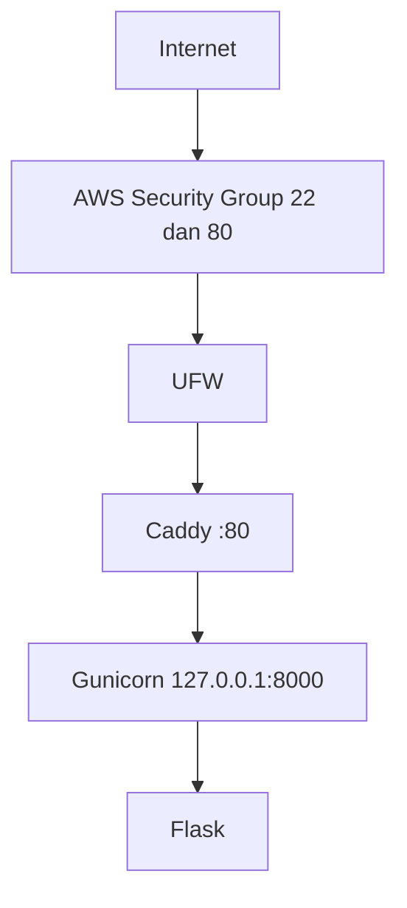
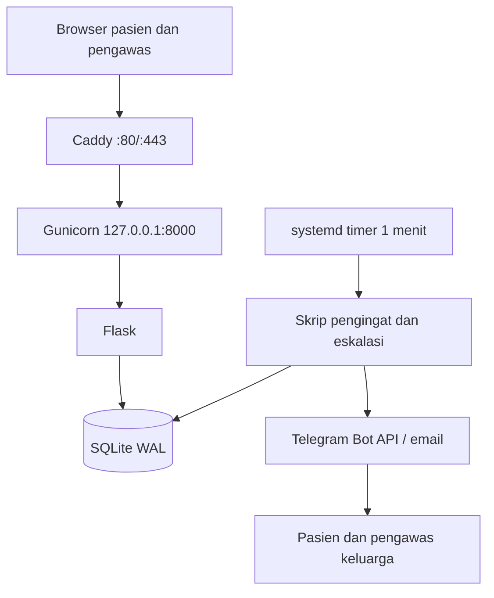

# Architecture v0.1

## Deployment View (M03, sesuai implementasi)

## Planned Architecture (rencana M04–M12, belum diimplementasikan)

## Resource Constraints
- AWS EC2 t3.micro, Asia Pacific (Sydney)
- 2 vCPU (batas praktikum template: 1 vCPU)
- RAM 909 MiB, swap 1 GB
- 20 GB disk

## Security Decisions
- non-root administration (`cloudstudent`)
- SSH key authentication
- password SSH disabled
- root SSH disabled
- UFW enabled (OpenSSH dan 80/tcp)
- AWS Security Group konsisten dengan UFW
- backend loopback-only

## Current Limitations
- HTTP only
- single VPS
- no database
- no container
- no CI/CD
- AWS Free Plan berakhir 06-04-2027

## Planned Evolution
- M04 DNS + HTTPS
- M05 persistent data (SQLite) + backup/restore
- M06 container
- M07 IaC
- M09 CI/CD
- M11–M12 pengingat, eskalasi, observability
