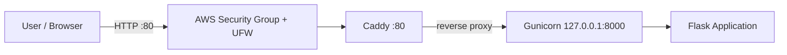
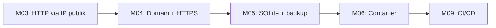

# Architecture v0.1

## Deployment View (M03)

## Komponen

| Komponen | Fungsi |
|---|---|
| AWS Security Group + UFW | Firewall: hanya port 22 (SSH) dan 80 (HTTP) dibuka |
| Caddy | Reverse proxy: menerima request publik dan meneruskannya ke Gunicorn |
| Gunicorn | Application server, hanya listen di 127.0.0.1:8000 (loopback) |
| Flask | Aplikasi web MediRemind |
| systemd | Menjalankan Gunicorn sebagai service dan memulai ulang otomatis |

## Rencana Evolusi

Komponen yang direncanakan pada milestone berikutnya:
- SQLite (mode WAL) untuk penyimpanan data (M05)
- systemd timer untuk penjadwal pengingat
- Telegram Bot API untuk notifikasi

## Prinsip Keamanan
- Backend hanya listen di loopback, tidak terbuka ke internet
- SSH key-only, login root dinonaktifkan
- Tidak ada secret di repository
- Hanya data sintetis

## Keterbatasan
- Masih HTTP (belum HTTPS)
- Belum ada database
- Satu server (single point of failure)
- Deployment manual
